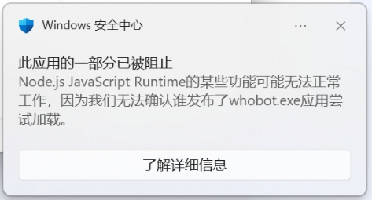
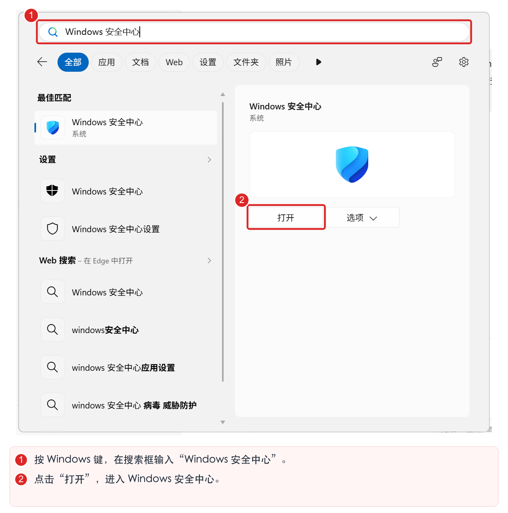
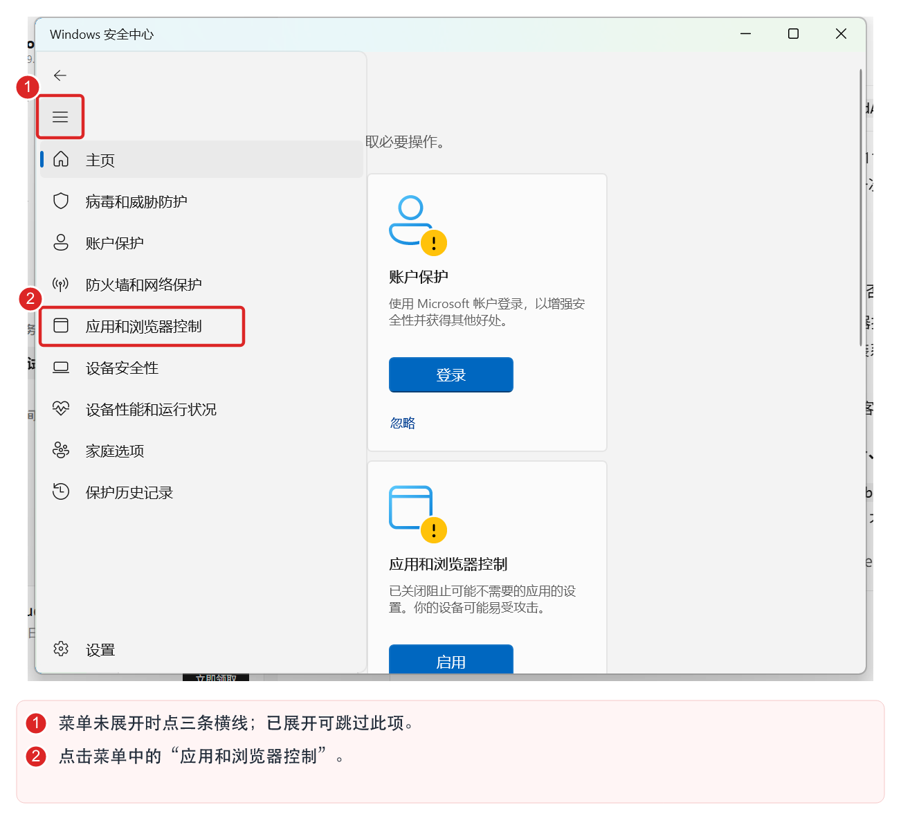
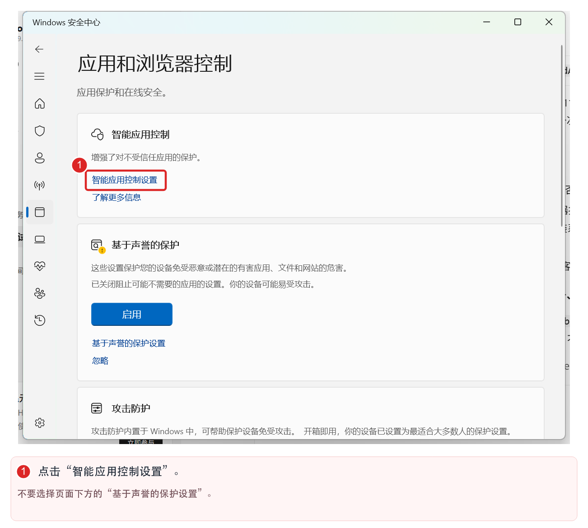
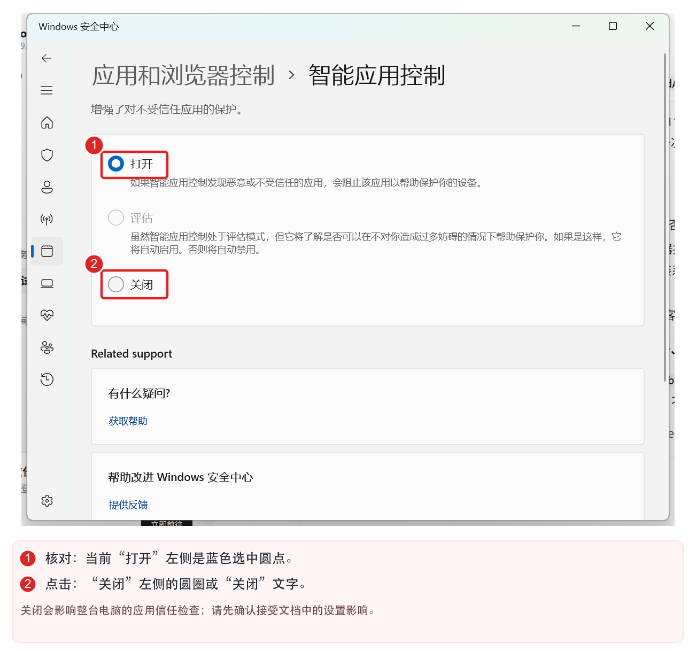
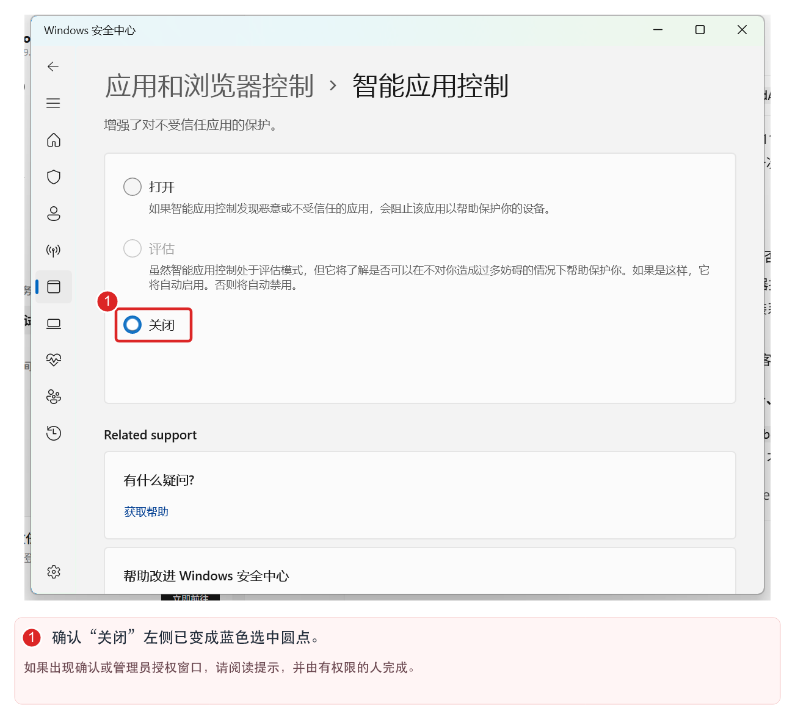
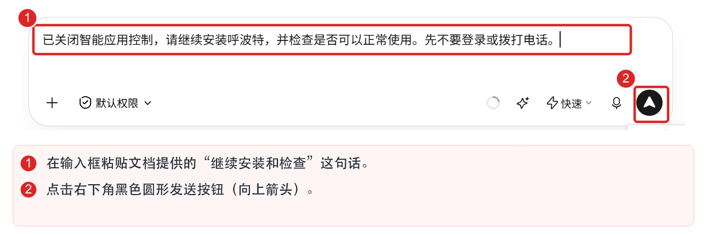

# Windows 安全拦截处理

**呼波特正在申请 Windows 应用程序数字签名。** 在签名完成前，部分开启“智能应用控制”的 Windows 11 电脑可能会阻止呼波特程序安装或运行。如果您遇到下方的安全提示，请先了解设置调整的影响，再按本文步骤完成安装。

**看图方法：** 按图中的数字顺序操作；红框标出需要点击或核对的位置。说明为“核对”或“确认”的内容只需检查状态，不需要再次点击。

## 确认问题

典型表现：

- Windows 安全中心提示 **“此应用的一部分已被阻止”**。
- 提示中出现 **Node.js JavaScript Runtime**，以及 `whobot.exe` 等呼波特程序名称。
- 你使用的 AI 工具提示程序被“应用程序控制策略”阻止，安装或运行失败；重复安装仍然失败。

下图是这类问题的 Windows 安全提示：



这类提示表示 Windows 未能确认程序的发布者或可信度。**“无法确认发布者”本身不等于已经检测到病毒。**

## 操作前需要知道

> 注意：**关闭智能应用控制会影响整台电脑对不受信任应用的拦截，不是仅允许呼波特一个程序。** 请先确认技能和安装程序来自呼波特官方或客服提供的渠道；公司统一管理的电脑，请让 IT 管理员处理。

本文只调整“智能应用控制”，不需要关闭 Defender 实时保护、防火墙，也不需要添加整盘或文件夹排除项。

能否重新开启与 Windows 版本及更新状态有关：近期 Windows 更新已支持重新开启，但部分旧版本或受管理设备可能有限制，请以本机界面提示为准。[微软说明：智能应用控制常见问题](https://support.microsoft.com/zh-cn/windows/security/threat-malware-protection/smart-app-control-frequently-asked-questions)

## 按图操作

### 第一步：打开 Windows 安全中心

按键盘上的 **Windows 键**，在图中 **1** 的搜索框输入 **Windows 安全中心**，再点击图中 **2** 的 **打开** 按钮。



### 第二步：进入“应用和浏览器控制”

如果左侧菜单未展开，先点击图中 **1** 的 **三条横线**。菜单展开后，点击图中 **2** 的 **应用和浏览器控制**。

**截图中菜单已经展开，可直接点击 2，不必再点 1。**



### 第三步：打开“智能应用控制设置”

找到页面上方的 **智能应用控制**，点击图中 **1** 红框圈出的 **智能应用控制设置** 链接。

注意选择这一项；页面下方的“基于声誉的保护设置”是另一项设置。



### 第四步：检查当前状态，选择“关闭”

先核对图中 **1**：当前选中 **打开**。确认可以进行前文所述的设置调整后，再点击图中 **2** 的 **关闭**。

如果这里原本就是关闭状态，请跳到本文最后的“仍然失败怎么办”，不要继续关闭其他安全功能。



### 第五步：确认“关闭”已经选中

核对图中 **1**：**关闭**左侧的圆点已变成蓝色选中状态。这一步只需确认，无需再次点击。若系统出现确认窗口，请阅读本机提示，确认接受后再继续；若要求管理员授权，请由设备管理员完成。



### 第六步：回到你使用的 AI 工具，继续安装和检查

回到你使用的 AI 工具，在原来的对话中粘贴下面这句话并发送。图中 **1** 是输入框，**2** 是发送按钮；不同工具的界面可能不同，请点击对应的发送按钮。

```text
已关闭智能应用控制，请继续安装呼波特，并检查是否可以正常使用。先不要登录或拨打电话。
```



如果原对话已结束，可以新建任务，明确要求使用已安装的“呼波特 AI 电话数字员工”技能进行安装和检查。

### 第七步：确认程序版本检查通过

等待你使用的 AI 工具完成安装和检查，根据它返回的结果，自行确认 **程序版本检查通过** 即可。

## 仍然失败怎么办

**设置是灰色、无法修改，或提示由组织管理：** 请联系电脑的 IT 管理员，不要自行修改注册表或企业应用控制策略。

**关闭后仍出现相同拦截：** 请把新出现的完整报错、发生时间和“智能应用控制”当前状态截图发给呼波特客服。Windows 通知中心可能保留旧通知，请留意通知时间；旧通知仍在，并不代表重新运行仍被拦截。

**报错变成网络连接、登录或版本问题：** 需要按新报错继续排查。程序能够启动，并不代表已经登录或所有业务功能都已验证。

**想恢复智能应用控制：** 在支持重新开启的系统中，可回到同一页面选择“打开”。签名完成前，程序仍可能再次被阻止；如需持续保留这项保护，请联系呼波特客服了解签名进展和适配情况。
